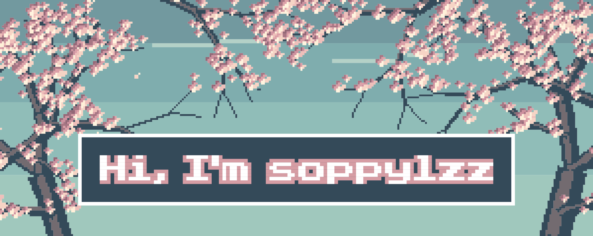

---

<h3>
<picture>
  <source media="(prefers-color-scheme: dark)" srcset="https://readme-typing-svg.demolab.com/?font=JetBrains+Mono&size=20&pause=1000&color=E5A6BA&center=true&vCenter=true&width=600&height=40&lines=Stack+%26+(+Vue+%7C+React+%7C+Typescript+);Theme+%26+(+Gitea+%7C+Slidev+%7C+Vitepress+);Developer+%26+(+AI+Agent+%7C+Frontend+%7C+Backend+);Research+%26+Remote+sensing" />
  
</picture>
</h3>

<h3><picture>
  <source media="(prefers-color-scheme: dark)" srcset="https://readme-typing-svg.demolab.com/?font=JetBrains+Mono&size=20&pause=1000&color=E5A6BA&center=true&vCenter=true&width=400&height=40&lines=Projects;Typescript+%26+(+Vue+%7C+Slidev+)" />
  
</picture></h3>

<picture>
  <source media="(prefers-color-scheme: dark)" srcset="https://github-readme-stats.vercel.app/api/pin/?username=soppylzz&repo=soppy-vue&hide_border=true&bg_color=00000000&title_color=58A6FF&text_color=C9D1D9" />
  
</picture>

<picture>
  <source media="(prefers-color-scheme: dark)" srcset="https://github-readme-stats.vercel.app/api/pin/?username=soppylzz&repo=soppy-slidev&hide_border=true&bg_color=00000000&title_color=58A6FF&text_color=C9D1D9" />
  
</picture>

<a href="https://github.com/soppylzz?tab=repositories">more projects →</a>

<h3><picture>
  <source media="(prefers-color-scheme: dark)" srcset="https://readme-typing-svg.demolab.com/?font=JetBrains+Mono&size=20&pause=1000&color=E5A6BA&center=true&vCenter=true&width=200&height=40&lines=Misc" />
  
</picture></h3>

<picture>
  <source media="(prefers-color-scheme: dark)" srcset="https://github-readme-stats.vercel.app/api?username=soppylzz&show_icons=true&hide_rank=true&include_all_commits=true&hide_border=true&bg_color=00000000&title_color=58A6FF&text_color=C9D1D9&icon_color=3FB950" />
  
</picture>

made with ❤️ and pixels

