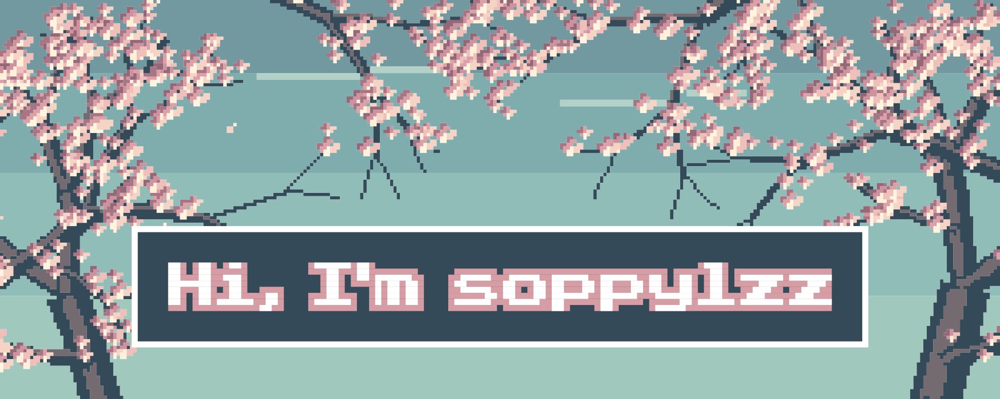
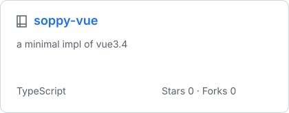
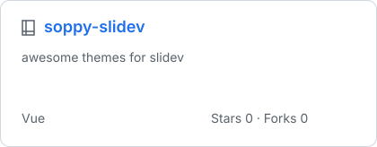
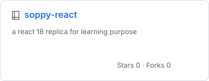
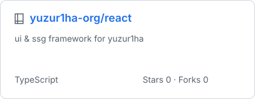
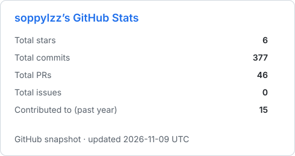

---

<h3>
<picture>
  <source media="(prefers-color-scheme: dark)" srcset="https://readme-typing-svg.demolab.com/?font=JetBrains+Mono&size=20&pause=1000&color=E5A6BA&center=true&vCenter=true&width=600&height=40&lines=Stack+%26+(+Vue+%7C+React+%7C+Typescript+);Theme+%26+(+Gitea+%7C+Slidev+%7C+Vitepress+);Developer+%26+(+AI+Agent+%7C+Frontend+%7C+Backend+);Research+%26+Remote+sensing" />
  
</picture>
</h3>

<h3><picture>
  <source media="(prefers-color-scheme: dark)" srcset="https://readme-typing-svg.demolab.com/?font=JetBrains+Mono&size=20&pause=1000&color=E5A6BA&center=true&vCenter=true&width=400&height=40&lines=Projects;Typescript+%26+(+Vue+%7C+Slidev+)" />
  
</picture></h3>

<a href="https://github.com/soppylzz/soppy-vue">
  <picture>
    <source media="(prefers-color-scheme: dark)" srcset="assets/projects/soppy-vue-dark.svg" />
    
  </picture>
</a>
<a href="https://github.com/soppylzz/soppy-slidev">
  <picture>
    <source media="(prefers-color-scheme: dark)" srcset="assets/projects/soppy-slidev-dark.svg" />
    
  </picture>
</a>
 
<a href="https://github.com/soppylzz/soppy-react">
  <picture>
    <source media="(prefers-color-scheme: dark)" srcset="assets/projects/soppy-react-dark.svg" />
    
  </picture>
</a>
<a href="https://github.com/yuzur1ha-org/react">
  <picture>
    <source media="(prefers-color-scheme: dark)" srcset="assets/projects/react-dark.svg" />
    
  </picture>
</a>

<a href="https://github.com/soppylzz?tab=repositories">more projects →</a>

<h3><picture>
  <source media="(prefers-color-scheme: dark)" srcset="https://readme-typing-svg.demolab.com/?font=JetBrains+Mono&size=20&pause=1000&color=E5A6BA&center=true&vCenter=true&width=200&height=40&lines=Misc" />
  
</picture></h3>

<a href="https://github.com/soppylzz">
  <picture>
    <source media="(prefers-color-scheme: dark)" srcset="assets/stats-dark.svg" />
    
  </picture>
</a>

made with ❤️ and pixels

